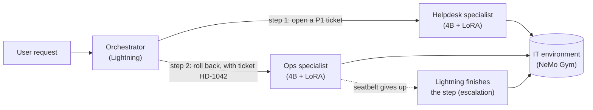
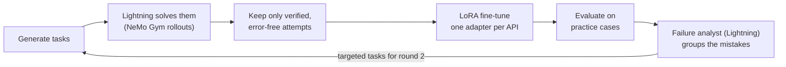

# Small-model IT operations team: project overview

Our entry for the NVIDIA x Red Hat Small Models Hack (Raleigh, October 17–18, 2026), in the Multi-Agent Systems track. This page describes what the system does and how we measure it. For the rules we work by, see `CLAUDE.md`; for the task list and progress, see `PLAN.md`.

## In short

A team of AI agents handles IT requests, such as "The payments app keeps crashing after this morning's deploy: roll it back and open a P1 ticket." A large model, **Nemotron 3.5 Lightning** (30B total, 3B active parameters), plans the work. Small **specialist** models, each a 4B model with its own LoRA adapter, make the tool calls: one specialist for the helpdesk and one for operations.

The specialists learn from Lightning. Lightning solves thousands of generated tasks in a simulated IT environment. We keep only the attempts a verifier proves correct, and fine-tune the small models on them.

The claim we are testing: **the team beats one small model that has every tool, and gets close to Lightning working alone, while each specialist needs a fraction of the memory.**

## What happens to a request

1. **Plan.** The orchestrator reads the specialists' cards (what each can do) and splits the request into steps. In the example, it opens the ticket first, because production changes need one.
2. **Act.** Each step goes to a specialist, along with results from earlier steps (here, the new ticket ID). The specialist works through a tool loop: it calls tools, reads the results and continues until the step is done.
3. **Seatbelt.** A reliability layer inside the tool loop:
   - It checks every tool call against the tool's schema before running it, and sends errors back to the model so it can correct itself.
   - It retries temporary outages (HTTP 503) automatically.
   - It allows two retries per step.
   - Before accepting a final answer, it asks the model whether it skipped a tool call it should still make.
4. **Escalate.** If the seatbelt gives up on a step, Lightning finishes that step from where it stopped, without repeating actions already taken. Only that step is billed at Lightning's price.

## The parts

### The IT environment (NeMo Gym)

A simulated company, built as a NeMo Gym resources server:
- **Helpdesk tools:** employees, devices, tickets and password resets (`list_devices`, `create_ticket`, `update_ticket`, `reset_password`, ...).
- **Ops tools:** a simulated cluster with `prod` and `staging` namespaces, deployments, pods, logs and rollout history (`get_pods`, `get_logs`, `rollout_history`, `rollback`, `scale`, ...).

The tools have realistic quirks, so a model can't guess its way through:
- Ticket IDs, device IDs, pod names and revision numbers all have to be looked up first.
- Any change in `prod` needs the ID of an open helpdesk ticket.
- Crash logs for broken releases come from real system logs (Loghub).

Every task starts from a fresh copy of a fixture, with a frozen clock and deterministic IDs. An optional "chaos" mode makes some calls fail temporarily.

**Scoring.** A verifier runs the task's correct ("gold") calls on one fresh copy and the model on another. It passes the attempt only if the two final states match exactly. For read-only questions, the answer must also contain the right facts, and must not list wrong ones. No language model judges correctness.

### The factory: Lightning teaches the specialists

- **Tasks.** Most tasks are sampled by code: code picks a valid action from the environment and computes the gold calls, and Lightning only phrases the request, in a style code picks. Code then checks the phrasing: the request must state what the action needs (a priority, a change ticket) and leave out what the assistant should look up or ask for. About 20% of tasks are written entirely by Lightning, and code checks that their gold calls run and that the request states every value they set. The kinds cover single actions in one or two steps, requests with missing information (the assistant should ask), and requests no tool should carry out.
- **Decontamination.** Tasks that copy a practice case are dropped: a request worded like one, the same situation for a request that changes nothing, or the same changes as a practice case or part of one.
- **Rollouts and filter.** Lightning solves each task inside NeMo Gym, with the same tools, seatbelt and limits as every eval setup. A rollout becomes training data only if the verifier passes it, no call failed, and the seatbelt never had to send Lightning back to work.

How Lightning thinks at each step. It can reason before answering ("thinking"), which costs tokens and time:

| Step | Thinking | Why |
|---|---|---|
| Phrasing a sampled task as a request | off | Code already chose the action; a sentence needs no reasoning, and code checks the result. |
| Writing a whole task | on | The gold calls must match the environment exactly. In a trial, 4 of 8 tasks written without thinking contradicted it (for example, a colleague's ticket under the wrong name); with thinking, the facts held. |
| Solving tasks (rollouts) | on | With thinking, the verifier passed 33/36 helpdesk and 30/36 ops practice attempts, against 27/36 and 21/36 without. |
| The student's training text | off | The student is evaluated with thinking off, so it learns from Lightning's calls and answers with the reasoning removed. |

**Rounds.** Round 1 is broad: about 1,300 helpdesk and 1,500 ops tasks spread over everything each API does (actions in one or two steps, requests that need a question back, requests to decline), aiming for about 1,000 verified examples per API. It trains the round 1 adapters. Round 2 is targeted: the failure analyst's clusters of round 1 mistakes on practice cases become about 300 new tasks per API. The task mix, files and methodology are in `data/generated/README.md`.

**Pilot** (helpdesk, 50 tasks, before round 1): 6 dropped as too close to practice cases, and 40 of the remaining 44 Lightning rollouts kept as training data. A person read 10 kept examples; one taught the wrong thing (Lightning offered to look up a colleague's private phone number, which the state check can't catch), so that kind of task was removed.
- **Training.** One LoRA adapter per API on the 4B student (rank 16, loss on assistant turns only). The data is rendered with the student's own chat template, so its tool calls parse correctly when served.
- **Round 2.** A failure analyst (Lightning, with structured output) groups the round 1 adapter's mistakes on practice cases. The factory then writes targeted tasks for those weak spots.

### Serving (vLLM)

vLLM serves Lightning on one server, and the student base model with every specialist adapter on another (multi-LoRA). We will measure what this buys us:
- memory and throughput: one multi-LoRA server vs separate servers;
- behavior under concurrent agent sessions;
- prefix caching on shared tool schemas;
- how reliable structured outputs are;
- speculative decoding for Lightning, if vLLM supports it for this model.

## How we measure it

Every setup runs under identical conditions: the same NeMo Gym eval configuration, tools, sampling settings, step limit and seatbelt limits. Each case runs 3 times and passes if at least 2 attempts pass. Results are reported as fractions such as `37/50`.

**Specialist ladder**, per API, on that API's own cases. Each row changes one thing, so each improvement is isolated:

| Setup | What changes |
|---|---|
| `base_raw` | student base model, no seatbelt |
| `base_seatbelt` | + the seatbelt |
| `r1` | + round 1 LoRA adapter |
| `r2` | + round 2 (targeted) adapter |
| `lightning` | Lightning alone, for reference |

**System comparison**, on requests that need both APIs:

| Setup | Description |
|---|---|
| `single_base`, `single_trained`, `single_lightning` | one model with every tool, no orchestrator |
| `team_base` | Lightning orchestrator, untrained specialists |
| `team_trained` | Lightning orchestrator, trained specialists |
| `team_escalate` | `team_trained` plus escalation to Lightning |
| `team_small_planner` (optional) | `team_trained` with the 4B student as orchestrator, to measure Lightning's value as planner |

We also report latency and cost per 1,000 requests (from GPU price and measured throughput), and for `team_escalate`, the share of steps the small models handled.

**Held-out test set.** Developer write the test cases, and they stay locked. No code, model or training data touches them until the final run. The factory and the failure analyst only ever see results on the separate practice cases.

## Models

| Role | Model | Parameters |
|---|---|---|
| Orchestrator, teacher, failure analyst, escalation | `nvidia/NVIDIA-Nemotron-3.5-Lightning-30B-A3B-BF16` | 30B total, 3B active |
| Specialists (base + LoRA adapters) | `nvidia/NVIDIA-Nemotron-3-Nano-4B-BF16` | 3.97B |

Every generative model is 33B parameters or fewer, per the event rules (per model, confirmed by the organizers). Everything runs on one H200 GPU.

## Data

- **Synthetic tasks and verified Lightning trajectories.** Published on Hugging Face with their generation configs, seeds and methodology.
- **Loghub** system logs, used to make the simulated pod logs realistic. They keep Loghub's own license.
- **NeMo Gym Workplace Assistant** and **NVIDIA When2Call**, as evaluation-only checks. They confirm that fine-tuning didn't hurt general tool use or the model's sense of when not to call a tool.

Every outside source is listed with its license in `data/open/DATA_SOURCES.md`.

## What we are submitting

- **Main track, Multi-Agent Systems:** the team of specialists coordinated by Lightning.
- **NeMo Gym bounty:** the IT environment, plus baseline vs final scores on held-out tasks, with each improvement isolated (seatbelt, round 1, round 2).
- **Nemotron Lightning bounty:** Lightning as teacher, orchestrator, failure analyst and escalation target, measured three ways:
  - as planner, against a small planner;
  - as teacher, by how many of its attempts pass verification;
  - through escalation.
- **Red Hat vLLM bounty:** vLLM serving Lightning and every specialist adapter, with measured serving results.
- **Demo:** a Gradio app that shows the plan, each specialist step, each tool call, seatbelt events, escalations, and the change in the environment, next to a single-model run of the same request.

## Status (2026-10-17)

| Stage | State |
|---|---|
| 0. Repo, serving (vLLM), model client | done |
| 1.1 NeMo Gym environment and verifier | done |
| 1.2 Seatbelt, tool loop, Gym agent, eval runner, practice cases, baseline | done: practice cases reviewed; baseline in `runs/practice_baseline.md` |
| 2.1 Tasks and Lightning rollouts | in progress: pipeline built and tested, helpdesk pilot reviewed; round 1 tasks being generated |
| 2.2–2.3 Round 1 and round 2 training | not started |
| 3. Specialists, orchestrator, system baselines, escalation | not started |
| 4. vLLM serving benchmarks | not started |
| 5. Final test-set run, README and write-ups, demo and video | not started |

`PLAN.md` tracks each task and its "Done when" check.
