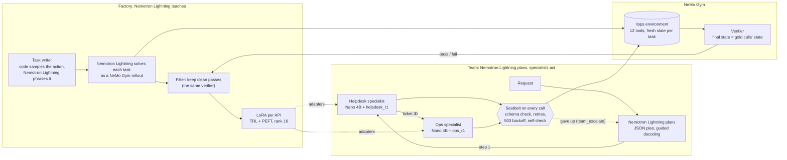

# Lightning & the Specialists

A small-model IT operations team, built for the NVIDIA x Red Hat Small Models Hack (Raleigh, October 17–18, 2026) in
the fine-tuning track. **NVIDIA Nemotron 3.5 Lightning** (30B-A3B; "Nemotron Lightning" below) plans each
request and taught the team. Small **NVIDIA Nemotron 3 Nano 4B** specialists, one LoRA adapter per API, make the tool
calls. **NeMo Gym** hosts the environment and scores
every attempt by its final state, and **vLLM** serves every model on one H200.

**The result:** LoRA fine-tuning on Nemotron Lightning's verified work lifted the 4B model from 5/10 to 8/10 held-out
helpdesk cases, above Nemotron Lightning's own 6/10, and from 5/10 to 7/10 on ops.

> "The payments app keeps crashing after this morning's deploy: roll it back and open a P1 ticket."

Nemotron Lightning's plan opens the ticket first, because a production change needs one. The helpdesk specialist opens HD-1042,
the ops specialist rolls payments back from revision 9 to 8 with that ticket, and the verifier checks the final state.

**Team:** Sachin Kumar, Senior Data Scientist III at LexisNexis (solo entry). GitHub:
[@techsachinkr](https://github.com/techsachinkr).
**Bounties:** NeMo Gym, Nemotron Lightning and Red Hat vLLM ([write-ups](#bounty-write-ups)).

## Results on the held-out test set

35 cases (10 helpdesk, 10 ops, 15 that need both APIs), each run 3 times; a case passes when at least 2 of its 3
attempts pass. All 15 runs are commit `997e6a0`, chaos off, every attempt collected. Source:
[`runs/final/report.md`](runs/final/report.md); each run's config, summary and per-case results are in
`runs/final/<setup>/`.

**The test set is AI-written.** No human-written set existed, so a fresh Claude Code subagent, of the same model
family that built the system, wrote it from [`TEST_SET_GUIDE.md`](TEST_SET_GUIDE.md), the fixtures and the tools. It was
told not to read the practice cases, generated data, runs, prompts or the agents' code, and not to run any model. The
session that built the system never opened it, and nothing was tuned on it.

**Specialist ladder.** Each row changes one thing. Cases passed, with attempts passed in brackets:

| setup | what it is | helpdesk | ops |
|---|---|---|---|
| `base_raw` | Nano 4B, no seatbelt | 6/10 (17/30) | 5/10 (18/30) |
| `base_seatbelt` | + the seatbelt | 5/10 (15/30) | 5/10 (18/30) |
| `r1` | + the round 1 LoRA adapter | **8/10 (23/30)** | **7/10 (21/30)** |
| `lightning` | Nemotron Lightning alone, for reference | 6/10 (18/30) | 9/10 (27/30) |

**System**, on the 15 multi-API cases:

| setup | what it is | cases | attempts | mean latency | $ per 1,000 requests |
|---|---|---|---|---|---|
| `single_base` | one Nano 4B with all 12 tools, no planner | 7/15 | 20/45 | 12.5 s | 0.54 |
| `single_trained` | one Nano 4B + `all_r1`, all 12 tools | 8/15 | 24/45 | 12.6 s | 0.42 |
| `single_lightning` | Nemotron Lightning alone, all 12 tools | 10/15 | 30/45 | 11.7 s | 0.79 |
| `team_base` | Nemotron Lightning plans, untrained specialists | 6/15 | 18/45 | 16.4 s | 0.58 |
| `team_trained` | Nemotron Lightning plans, trained specialists | 8/15 | 25/45 | 21.5 s | 0.53 |
| `team_escalate` | `team_trained` + escalation to Nemotron Lightning | 7/15 | 24/45 | 20.7 s | 0.53 |
| `team_small_planner` | Nano 4B plans, trained specialists | 5/15 | 17/45 | 9.4 s | 0.38 |

What the results say:

- Training helps both specialists on held-out cases (helpdesk 5/10 to 8/10, ops 5/10 to 7/10), and the trained
  helpdesk specialist beats Nemotron Lightning on helpdesk (8/10 against 6/10).
- The seatbelt alone adds nothing to the scores, as on the practice cases. It's there for reliability: schema checks,
  automatic 503 retries and the self-check.
- The team does **not** beat one trained model with every tool: `team_trained` and `single_trained` tie (8/15 each,
  25/45 against 24/45 attempts). Nemotron Lightning alone does best (10/15).
- Nemotron Lightning as planner is worth 8 attempts (25/45 against the 4B planner's 17/45), and training is worth 7 inside the
  team (`team_base` 18/45).
- No step needed escalation: all 87 of `team_escalate`'s steps ran on small models.
- With 10 or 15 cases, one case is within noise; the attempts are a finer measure.

**Cost** is GPU time at full load: one H200 at $6.53 an hour over each model's measured throughput
([`configs/eval.yaml`](configs/eval.yaml)). Adapters are priced as the student base model. That understates the setups
that run them (`r1`, `single_trained`, `team_trained`, `team_escalate`): LoRA serving is slower, 46% more time per
output token at 1 session ([vLLM results](#red-hat-vllm)).

**Test overlap.** Before the final run, `eval/decontaminate.py --against test` found 54 of 1,085 helpdesk and 203 of
1,016 ops training examples with the same state changes as a test case. `helpdesk_r1`, `ops_r1` and `all_r1` were
retrained without them (`data/generated/<api>/round_1_test_clean.jsonl`), and the results above use the retrained
adapters. The practice results during development came from the original adapters.

## How the specialists were fine-tuned

| what | setting |
|---|---|
| base model | NVIDIA Nemotron 3 Nano 4B (BF16), evaluated with thinking off |
| data | 1,844 verified Nemotron Lightning trajectories: helpdesk 1,031 and ops 813 (`data/generated/<api>/round_1_test_clean.jsonl`), 5% of each held out for eval loss |
| text | each trajectory rendered with the student's own chat template and tool list, with Nemotron Lightning's reasoning removed, so the tuned model's tool calls parse in vLLM |
| method | LoRA with TRL + PEFT: rank 16, alpha 32, dropout 0.05, on the `q_proj`, `k_proj`, `v_proj`, `o_proj`, `up_proj`, `down_proj` and `in_proj` projections; 17.1M parameters per adapter |
| training | learning rate 2e-4, cosine schedule with 3% warmup, 2 epochs, 16 examples per optimizer step (2 × 8 accumulation), up to 8,192 tokens, loss on assistant turns only, seed 0 ([`configs/factory.yaml`](configs/factory.yaml)) |
| adapters | `helpdesk_r1` and `ops_r1`, one per API; `all_r1` on both APIs' examples with every tool in the prompt, for the one-model baseline |
| runs | 124, 98 and 220 optimizer steps in 14, 11 and 38 minutes on the H200, next to both vLLM servers (up to 26.4 GB reserved); held-out eval loss 0.221, 0.279 and 0.243 |
| check | `scripts/smoke_toolcall.py`: 20/20 tool calls parsed for each adapter |

The commands are in the [quick start](#quick-start).

## How it works



- **Environment (NeMo Gym).** One resources server, `itops` (`resources_servers/itops/` starts `gym_env/server.py`),
  with 6 helpdesk tools (tickets, devices, password resets) and 6 ops tools (deployments, pods, logs, rollout history,
  rollback, scale) over a simulated company. Every task gets a fresh copy of its fixture, with a frozen clock and
  deterministic IDs. Any change in `prod` needs the ID of an open helpdesk ticket. Pod logs are built from real
  Loghub samples. Chaos mode makes a seeded share of calls return 503.
- **Verifier** ([`gym_env/verify.py`](gym_env/verify.py)). It runs the task's gold calls on one fresh copy and the
  system on another, and passes the attempt only if the final states match. The final answer must also contain any
  required strings. No LLM judges correctness.
- **Factory** (`factory/`). Code samples a valid action and computes its gold calls, and Nemotron Lightning phrases the request;
  about 1 task in 5 Nemotron Lightning writes whole. Near-copies of the practice cases are dropped. Nemotron Lightning solves each task
  as a NeMo Gym rollout, and a rollout becomes training data only if the verifier passes it and no call failed. Then one
  LoRA adapter per API, trained with loss on assistant turns only, on text rendered with the student's own chat
  template. Methodology: [`data/generated/README.md`](data/generated/README.md).
- **Team** (`agents/`). Nemotron Lightning reads the specialists' cards ([`agents/cards/`](agents/cards/), with the fields of an
  A2A Agent Card), writes a JSON plan, and hands each step to a specialist. Results such as a ticket ID pass to the
  steps that depend on them.
- **Seatbelt** ([`common/seatbelt.py`](common/seatbelt.py)). Inside every tool loop: a call's arguments are checked
  against the tool's JSON schema before it runs, a step gets 2 retries, 503s are retried 3 times with backoff without
  the model, and before a step ends a self-check asks whether a tool call is still needed.
- **Escalation** (`team_escalate` only). When the seatbelt gives up on a step, Nemotron Lightning finishes it from where it
  stopped, without repeating any action.
- **Serving** (vLLM 0.27.1). Nemotron Lightning on port 8000. The student with every adapter on port 8001 (multi-LoRA).

### Models

| role | model | parameters (official) |
|---|---|---|
| planner, teacher, escalation, reference | NVIDIA Nemotron 3.5 Lightning 30B-A3B, BF16 ([`nvidia/NVIDIA-Nemotron-3.5-Lightning-30B-A3B-BF16`](https://huggingface.co/nvidia/NVIDIA-Nemotron-3.5-Lightning-30B-A3B-BF16)) | 30B total, 3B active |
| specialists | NVIDIA Nemotron 3 Nano 4B, BF16 ([`nvidia/NVIDIA-Nemotron-3-Nano-4B-BF16`](https://huggingface.co/nvidia/NVIDIA-Nemotron-3-Nano-4B-BF16)), plus the LoRA adapters `helpdesk_r1`, `ops_r1` and `all_r1` | 3.97B; each adapter 17.1M |

Each generative model is under the event's 33B limit, which the organizers confirmed applies per model, not to a
combined total (2026-10-17; `PLAN.md`, task 0.1, Q1). Revisions are pinned in
[`configs/models.yaml`](configs/models.yaml).

### Hardware

One H200 (140.4 GiB) holds everything. Nemotron Lightning's server takes 79.7 GiB (0.55 of the GPU), the student's with every
adapter 22.9 GiB (0.15), and LoRA training reserved up to 29.5 GiB next to both. The GPU peaked at 127.1 GiB in a
training dry run. Details: [`configs/gpu.md`](configs/gpu.md).

## Quick start

Without a GPU, on Linux with Python 3.13 and [uv](https://docs.astral.sh/uv/):

```bash
git clone https://github.com/techsachinkr/small-model-itops-team && cd small-model-itops-team
uv sync              # core dependencies and NeMo Gym 0.6.0 (Gym installs only on Linux)
uv run pytest -q     # 309 tests, CPU only
```

With a GPU (we used one H200; everything at once needs about 130 GiB):

```bash
uv sync --group train
uv venv .venv-vllm --python 3.13
uv pip install --python .venv-vllm/bin/python vllm==0.27.1 --exclude-newer 2026-10-03T00:00:00Z
scripts/serve_lightning.sh        # port 8000, in the background (about 2 min to start); log and PID in runs/vllm/
# The three adapters the final run used (about 14, 11 and 38 minutes on the H200)
uv run --group train python -m factory.train_lora --api helpdesk --round 1 --data data/generated/helpdesk/round_1_test_clean.jsonl
uv run --group train python -m factory.train_lora --api ops --round 1 --data data/generated/ops/round_1_test_clean.jsonl
uv run --group train python -m factory.train_lora --api all --round 1 \
  --data data/generated/helpdesk/round_1_test_clean.jsonl data/generated/ops/round_1_test_clean.jsonl
scripts/serve_student.sh          # port 8001: the student plus every adapter in adapters/
uv run python scripts/smoke_toolcall.py --model helpdesk_r1 --min-parsed 19   # the adapter's tool calls parse
scripts/stop_vllm.sh              # stops both servers when you're done
```

No API keys are needed. The optional environment variables are in [`.env.example`](.env.example).

## Run scoring

Every setup runs as a NeMo Gym agent against the same resources server and verifier, with the same settings
(`configs/eval.yaml`: temperature 0.6, top-p 0.95, thinking off, 10 turns per step, 3 attempts per case). The
single-model setups run as `itops_agent` and the team setups as `itops_team`. `eval/run_eval.py` starts and stops the
Gym servers itself (port 11000 must be free) and writes `runs/<run_id>/`: the resolved config and git commit, the
rollouts and traces, `summary.json` and `per_case.json`. It refuses to start with chaos on or with `LLM_MODE=replay`.

```bash
# A ladder setup on one API's practice cases
uv run python -m eval.run_eval --setup base_seatbelt --api helpdesk --split practice
uv run python -m eval.run_eval --setup r1 --api ops --split practice              # needs ops_r1 on the student server
# A system setup on the multi-API cases (no --api)
uv run python -m eval.run_eval --setup team_trained --split practice
# The held-out test set, as in runs/final/ (refused without --final)
uv run python -m eval.run_eval --setup r1 --api helpdesk --split test --final --run-id rerun/r1_helpdesk
# A results table for any set of runs
uv run python -m eval.report --run rerun/r1_helpdesk [--run <run_id> ...] --output report.md
```

| setups | servers they need |
|---|---|
| `base_raw`, `base_seatbelt`, `r1`, `single_base`, `single_trained`, `team_small_planner` | the student (port 8001) |
| `lightning`, `single_lightning` | Nemotron Lightning (port 8000) |
| `team_base`, `team_trained`, `team_escalate` | both |

## Reproduce the demo

The Gradio page runs the demo request on the team (`team_escalate`) and, side by side, on `single_base`. It shows
Nemotron Lightning's plan, every step and tool call, seatbelt events, escalations, the state change, the verifier's verdict, and
two counters: the share of steps handled by small models, and the cost of the request.

```bash
uv run --group demo python -m demo.app          # http://127.0.0.1:7860; over ssh: ssh -L 7860:localhost:7860 <host>
uv run python -m demo.rehearse --mode record    # record the three takes (both servers up)
uv run python -m demo.rehearse --mode replay    # check that they replay exactly
scripts/demo_reset.sh                           # before presenting; it must end with "demo_reset: ready"
```

On the Live tab, keep the demo request, tick Helpdesk and Ops, chaos off, Models: live, and click Run. Then turn chaos
on (rate 0.3, seed 5) and run again. Models: replay answers from the recordings in `runs/cache/` with no GPU. The
recordings aren't in the repo, so record them first.

## Data and provenance

| data | what it is | how it's used |
|---|---|---|
| `data/practice/` | 32 hand-written cases (12 helpdesk, 12 ops, 8 multi-API) | development: every design choice was checked on these |
| `data/test/` | 35 AI-written cases (10 helpdesk, 10 ops, 15 multi-API) | the held-out results above; locked during development |
| `data/generated/` | synthetic tasks and verified Nemotron Lightning trajectories, each file with its generation config and seed ([methodology](data/generated/README.md)) | training: 2,800 task slots, 2,347 Nemotron Lightning rollouts after writer failures and near-copies of practice cases were dropped, 2,101 clean passes, and 1,844 examples after dropping the 257 too close to a test case (helpdesk 1,031, ops 813) |
| `data/open/loghub/` | Loghub's `OpenStack_2k`, `Zookeeper_2k` and `Hadoop_2k` samples ([logpai/loghub](https://github.com/logpai/loghub)) | the canned ops logs in `gym_env/fixtures/logs.json` |

No outside dataset is used for training or evaluation. [`data/open/DATA_SOURCES.md`](data/open/DATA_SOURCES.md) lists
every source with its license, and the ones considered and not used. The planned Workplace Assistant and When2Call
regression checks were cut for time and never run.

## Bounty write-ups

### NeMo Gym

**Our Gym setup.** The `itops` resources server (`resources_servers/itops/`, starting `gym_env/server.py`): 12 tools
whose schemas are generated from code (`gym_env/tools.py`), isolated state per task (`gym_env/env.py`), seeded chaos
(`gym_env/chaos.py`), and the state-match verifier (`gym_env/verify.py`). Our cases become Gym task rows in
`gym_env/tasks.py`. Two agents: `itops_agent` (`responses_api_agents/itops_agent/`, our tool loop with the seatbelt)
for the single-model setups, and `itops_team` for the team setups. `gym_configs/eval.yaml` and `eval_team.yaml` hold
the shared settings, and each setup's own file sets only its model, adapter or agent. The factory's Nemotron Lightning rollouts
also run through Gym (`factory/collect.py`), so training data is filtered by the same verifier that scores the evals.

**Baseline against final, on the same held-out tasks and eval config:**

| | helpdesk | ops |
|---|---|---|
| baseline: `base_seatbelt` | 5/10 (15/30) | 5/10 (18/30) |
| final: `r1` | 8/10 (23/30) | 7/10 (21/30) |

**What caused each improvement.** Each ladder row changes one thing. The seatbelt (`base_raw` to `base_seatbelt`)
changed nothing within noise. The gain comes from the round 1 adapter alone: Nemotron Lightning's verified rollouts from the
same Gym environment, decontaminated against the practice and test cases, LoRA rank 16. Round 2 was cut, so there is
no `r2` row. **How to run scoring:** see [Run scoring](#run-scoring).

### NVIDIA Nemotron 3.5 Lightning

**What Nemotron Lightning does.** It is the teacher: it wrote the request for each of 2,800 task slots (about a fifth of them
whole, gold calls included), and solved 2,347 tasks as NeMo Gym rollouts. It is the planner: it splits each request into steps for the specialists. It is the
escalation target, and the reference row in every table. (The failure analyst it was also meant to be was cut with
round 2.)

**Why Nemotron Lightning.** It is the strongest model we could run under the 33B limit next to the specialists on one GPU:
alone, it is the best setup on the test set (10/15). With 3B active parameters per token, it answered the system cases
about as fast as one 4B model (11.7 s against 12.5 s on average).

**How we optimized it.**
- Thinking only where it pays: on for writing whole tasks and for solving them (on practice, 33/36 helpdesk and 30/36
  ops attempts passed with thinking, against 27/36 and 21/36 without), off for phrasing sampled tasks.
- Guided decoding for plans: without it, 8/24 of Nemotron Lightning's plans fit the schema; with it, 24/24, at half the tokens
  and latency (197 against 403 tokens, 2.45 against 5.22 s).
- Compact JSON (`disable_any_whitespace`), after a self-check answer generated whitespace until `max_tokens`.
- A self-check that asks "is a tool call still needed?": asked "is the task complete?", Nemotron Lightning said no whenever it
  had rightly asked the user a question, and correct attempts were thrown away.
- Escalation continues the stopped step instead of restarting it, so Nemotron Lightning only does the rest of the step.
- Served as its model card says: prefix caching on, its Mamba cache settings, `--max-num-seqs 128`.

**The evidence.**
- As planner: `team_trained` 8/15 (25/45) against `team_small_planner` 5/15 (17/45), the same specialists with the 4B
  model planning.
- As teacher: 1,085 of 1,198 helpdesk and 1,016 of 1,149 ops rollouts passed the verifier cleanly, and the specialists
  trained on them improved on held-out cases (5/10 to 8/10 and 5/10 to 7/10).
- Through escalation: on the test set no step needed it (0 of 87 steps). On the practice cases, 2 of 51 steps were
  escalated and one attempt was rescued.

### Red Hat vLLM

**How vLLM fits.** Two vLLM servers share one H200 and serve every model call: plans, specialist steps, self-checks,
the factory's rollouts and every eval. Nemotron Lightning runs on port 8000 at 0.55 of the GPU. The student runs on port 8001 at
0.15 with every adapter (`--enable-lora --max-lora-rank 16 --max-loras 4`), with runtime loading on, so a newly trained
adapter can be added without a restart. Tool calls are parsed by `--tool-call-parser qwen3_coder` and reasoning by
`--reasoning-parser nemotron_v3`.

**Configuration** (`scripts/serve_*.sh`, `configs/gpu.md`):
- Structured outputs with `{"backend": "xgrammar", "disable_any_whitespace": true}` for plans and self-checks.
- `--max-num-seqs 256` for the student: at 0.15 of the GPU it has 643 Mamba cache blocks, one per running sequence,
  so vLLM's default of 1024 doesn't start.
- Nemotron Lightning with its card's settings: prefix caching, Mamba SSM cache in float16 with stochastic rounding, the
  flashinfer Mamba backend, `--max-num-seqs 128`. Both at `--max-model-len 32768`.
- Prices from measured throughput (`vllm bench serve`, $6.53 an hour): Nemotron Lightning $0.032 per 1M prompt and $0.459 per 1M
  completion tokens, the student $0.023 and $0.192.

**Measured results** ([`runs/bench/summary.md`](runs/bench/summary.md); our own traffic: every model call of the `r1`
practice runs, replayed with `vllm bench serve`). One server with both adapters (A) against one merged server per
specialist, in the same memory (B1) or twice it (B2):

| configuration | GPU memory | cache tokens | output tok/s at 1 / 8 / 32 sessions | time per output token, 1 session |
|---|---|---|---|---|
| A: one server, LoRA | 21,650 MiB | 624,230 | 219 / 744 / 1,239 | 3.8 ms |
| B1: two merged servers, A's memory | 20,627 MiB | 165,478 | 323 / 875 / 1,459 | 2.6 ms |
| B2: two merged servers, twice A's memory | 43,079 MiB | 1,287,782 | 325 / 861 / 1,631 | 2.6 ms |

- In the same memory, multi-LoRA holds 3.8 times the cache of separate merged servers (B1's time to first token at 32
  sessions is 557 ms at p95, against A's 360 ms). Merged models are faster per token: 18% more output tokens per
  second at 32 sessions in the same memory, 32% with twice the memory. We kept multi-LoRA: one server for every
  specialist, and room for training next to it.
- Greedy completions from the merged models match the adapters' in 15 of 16 calls (BF16 merges can round differently).

Structured outputs, with and without guided decoding (`bench/structured.py`):

| request | model | guided | fits the schema | mean output tokens | mean latency |
|---|---|---|---|---|---|
| plan | Nemotron Lightning | on | 24/24 | 197 | 2.45 s |
| plan | Nemotron Lightning | off | 8/24 | 403 | 5.22 s |
| plan | student | on / off | 24/24 / 21/24 | 130 / 172 | 1.60 / 2.06 s |
| self-check | Nemotron Lightning | on / off | 80/80 / 68/80 | 55 / 69 | 1.66 / 1.76 s |
| self-check | the specialist's adapter | on / off | 80/80 / 80/80 | 54 / 59 | 0.66 / 0.66 s |

Without guided decoding most of Nemotron Lightning's plans would be invalid, and an attempt without a valid plan scores 0.

## Limitations

- **A small, AI-written test set.** 35 cases, written by an agent of the same model family that built the system. One
  case is within noise.
- **The team adds no accuracy over one fine-tuned model.** One fine-tuned 4B with every tool ties the team (8/15 each),
  Nemotron Lightning alone does best (10/15), and the team is slower: about 21 s a request against 12 s.
- **Costs understate the adapters,** which are priced as the student base model although LoRA serving takes 46% more
  time per output token at 1 session.
- **Differences between setups by design.** Turn and retry budgets are per step: a team attempt can have up to 6
  steps, each with its own, and an escalated step gives Nemotron Lightning its own. The single-model setups see all 12 tools
  against a specialist's 6. The practice runs came from 5 commits; the final run from one.
- **Escalation is unmeasured on the test set:** no step needed it.
- **The planner can assume a specialist that isn't there.** In the demo's helpdesk-only take, Nemotron Lightning's plan said the
  rollback needed an ops specialist "not listed in the cards, but implied", left it out of the uncovered steps, and asked
  the helpdesk specialist to note which revision payments was rolled back to. The specialist noted "revision 2.1.3",
  which doesn't exist, and only the verifier's state check caught it.
- **Cut for time:** round 2 (`factory/analyst.py` and `factory/run_round.py` are placeholders), the prefix-caching and
  speculative-decoding benchmarks, and the Workplace Assistant and When2Call regression checks, so we haven't checked
  that fine-tuning kept general tool use.
- **A simulated environment.** Ops is a simulation, never a real cluster, over one company and a few fixtures.
- **Not published separately.** The data is in this repo; the adapters aren't, and the quick start retrains them.
  The demo's replay recordings aren't in the repo either.

## Next steps

1. Tell the planner that only the listed specialists exist, and make every value from another step a dependency.
2. Round 2: the failure analyst and targeted tasks, starting with ops, where the specialist trails Nemotron Lightning (7/10
   against 9/10).
3. A larger, human-written test set.
4. Score `team_trained` with chaos on.
5. The cut benchmarks: prefix caching on the shared tool schemas, and speculative decoding for Nemotron Lightning.
6. Price the adapters at their own measured LoRA throughput.
7. The Workplace Assistant and When2Call regression checks.
8. Wrap the specialists with the A2A SDK (their cards already use Agent Card fields), and add a calendar specialist.

## Repo layout

```
configs/      models.yaml (pinned models), eval.yaml (shared eval settings and prices), gpu.md, factory.yaml
gym_env/      the environment: state, helpdesk and ops tools, chaos, verifier, fixtures, Gym server
resources_servers/itops/, responses_api_agents/itops_agent/, responses_api_agents/itops_team/   Gym entry points
gym_configs/  NeMo Gym configs: the shared ones and one per setup
common/       llm.py (every model call outside Gym), seatbelt.py, tool_loop.py, schemas.py, gym_agent.py
agents/       the planner (orchestrator.py), specialists, registry and cards
factory/      task sampler and writer, Gym rollout collection, filter, LoRA training, test-overlap removal
eval/         run_eval.py (wraps Gym), decontaminate.py, report.py
bench/        vLLM serving benchmarks
demo/         the Gradio page, its core, the rehearsal script and the video script
data/         practice/, test/, generated/, open/
runs/final/   the final run: every setup's config, summary, per-case results, rollouts and traces
tests/        pytest
```

`CLAUDE.md` holds the rules the project was built by, `PLAN.md` every task with its decisions, and `COMMANDS_LOG.md`
every command run on the GPU box with its result.

## License

Apache-2.0 ([`LICENSE`](LICENSE)), except the log lines derived from Loghub (`data/open/loghub/`,
`gym_env/fixtures/logs.json`, and the tool results built from them in the generated trajectories), which keep Loghub's
own license ([`data/open/loghub/LICENSE`](data/open/loghub/LICENSE)). The models' licenses are in
[`configs/models.yaml`](configs/models.yaml).
